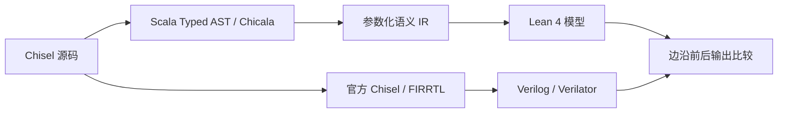

# Chisel2Lean4

把 **Chisel 3.5.6 源码中的模块生成器**自动转换成参数化、可执行的 Lean 4 模型。
复用 Chicala 的 Scala Typed AST 前端，经独立的带类型语义 IR 生成 Lean。
构造参数保持符号形式；生成代码无需人工修补。

当前版本：**0.2.0**。这是一个经过工程回归验证的 Chisel 源码转换器，
输出参数化的 `Params / Inputs / State / Outputs / step / output`。
生成模型可以执行，也可以作为 Lean 中证明电路性质的起点。

## 验收状态与正确性范围

本版在 Windows 上实际完成了以下检查，结构化记录见
[docs/validation.json](docs/validation.json)：

| 检查 | 结果 |
|---|---:|
| 自动生成并通过 Lean 检查的模块 | 51 |
| 与独立官方 RTL 对照的参数配置 | 128 |
| 执行周期 | 6,303 |
| 对照输出值 | 28,907 |
| 不支持语法、非法参数和未定义轨迹的拒绝检查 | 25 |
| 故意修改输出后检测出错误 | 通过 |
| 生成 Counter 模型上的客户端定理 | 2 条通过 |

**已测试配置和输入序列的输出全部一致。所有合法参数、所有输入序列上的
完整转换等价性尚未证明。** Lean 类型检查、有限 RTL 差分测试和生成模型
上的性质证明分别回答不同问题；报告明确记录
`formal_equivalence_proof: false`。

## 固定工具版本

| 工具 | 版本 |
|---|---|
| Chisel | 3.5.6 |
| Scala | 2.13.10 |
| sbt | 1.8.2 |
| Lean | 4.19.0 |
| Java | 17 |
| Python | 3.10+，脚本仅使用标准库 |

独立 RTL 参考路径使用官方 Chisel 编译器插件和 FIRRTL 1.5.6。
实际验收使用 Verilator 5.048。运行完整 RTL 验收还需要 C++ 编译器和 Make。

## 获取源码

```powershell
git clone https://github.com/yiling1-bot/chisel2lean4.git
cd chisel2lean4
```

该仓库为私有仓库，克隆账号需要有访问权限。新机器先按下方的构建步骤
安装项目依赖，然后执行示例。

支持矩阵见 [docs/support-matrix.md](docs/support-matrix.md)，语义约定见
[docs/semantics.md](docs/semantics.md)。本版覆盖常见单时钟设计：参数化
模块层次、UInt/SInt/Bool、Bundle/Vec、同步寄存器和位宽推导、条件状态机、
生成循环、动态数组访问、异步读 Mem 与一拍读 SyncReadMem。FIFO 和
寄存器文件使用真实源程序回归。BlackBox、多时钟、异步复位和随参数改变
声明布局的生成器仍有明确限制；详情按语言构造列在支持矩阵中。

## 直接使用

在已完成依赖构建的工作区直接运行。下列命令均以仓库根目录为工作目录：

在项目目录执行：

```powershell
python scripts/chisel2lean.py examples/Counter.scala --module Counter
python scripts/simulate.py generated/Counter.ir.json --params n=4 --trace examples/direct-counter-trace.json
```

也可以使用 `chisel2lean4.ps1` 包装器。第一条命令读取真实 Chisel 源码，
生成 `generated/Counter.lean`、带类型的 `Counter.ir.json` 和 manifest，
并默认进行 Lean 类型检查。第二条执行输入/复位序列，保存每拍边沿前后
输出和下一状态。示例计数状态为 `0, 1, 2, 2, 3, 0, 1`。

参数 n 可直接改为其他合法值；生成的模型中仍然是依赖 n 的 BitVec，
不需要重新手写或固定某个位宽的 Lean 电路。

## 多层模块和流水线示例

[Hierarchy.scala](audit/src/main/scala/Hierarchy.scala) 使用真实子模块连接：
`HierarchicalPipeline` 实例化两个 `PipelineLane(w + 1, ...)`，
`NestedHierarchy` 再包一层父模块。两个寄存器都保持参数化的 `w + 1` 位宽。

```powershell
python scripts/chisel2lean.py audit/src/main/scala/Hierarchy.scala --module probes.HierarchicalPipeline
python scripts/simulate.py generated/probes/HierarchicalPipeline.ir.json --params w=8 --trace examples/hierarchy-trace.json
```

本例的边沿更新规则是：复位时两个寄存器清零；使能时
`A' = input + 1`、`B' = 旧 A + 2`；关闭使能时都保持。
加法结果按 `w + 1` 位截断，输出来自 B。

| 示例操作 | 输入 | 边沿后 A | 边沿后 out |
|---|---:|---:|---:|
| 复位 | 0 | 0 | 0 |
| 使能 | 167 | 168 | 2 |
| 使能 | 49 | 50 | 170 |
| 关闭使能 | 27 | 50 | 170 |
| 使能 | 102 | 103 | 52 |

`NestedHierarchy` 的外层只连接端口，因此仍然只有两级寄存器。
层次例子的独立 RTL 回归包括流水线 `w=1/3/8`、三层模块 `w=2/5`，
以及三个组合层次配置，共 298 个周期、591 个输出值全部一致。
逐拍原始输入与 Lean/RTL 输出保存在
[experiments/differential-v0.2-extension](experiments/differential-v0.2-extension)。

## 在新环境构建

设置 `JAVA_HOME` 为 JDK 17，安装 Python 3.10+。脚本只使用 Python 标准库。
首次需要联网下载固定版本的公开依赖：

```powershell
python scripts/bootstrap.py
python scripts/sbt.py writeToolClasspath reference/writeReferenceClasspath
python scripts/chisel2lean.py examples/Counter.scala --module Counter
```

工具和缓存放在项目的 `.tools`、`.cache` 中。bootstrap 不改变全局版本；
官方 Lean 二进制来源和 SHA256 会记录在下载目录。Linux 需要 tar/zstd
支持；该主机的实际验收环境是 Windows。

`writeToolClasspath` 建立按 SHA256 标识的不可变编译器 jar 快照。
翻译器从同一快照加载插件与 JVM 类，避免打包期间读取一半更新的 jar。
修改转换器源码后执行该任务或使用翻译 CLI 的 `--rebuild`。

## 输入与输出

可以给出多个 Scala 文件：

```powershell
python scripts/chisel2lean.py Design.scala Ports.scala --module mypkg.Design --out generated
```

`--classpath` 接收额外依赖，Windows 用分号、Linux 用冒号分隔。
目标是顶层、直接继承 Module 或 RawModule 的类，首版构造参数为 Int/Boolean。
完整模块名可以消除同名模块歧义。构建版本始终为 Chisel 3.5.6 / Scala 2.13.10。

输出接口：

- `Params` 与 `valid p`：参数和合法域，包括源 require、Int 范围、宽度、
  字面值和索引条件。直接调用模型前也必须检查 valid。
- `Inputs p`、`State p`、`Outputs p`：保留参数化宽度/数组。
- `step p inputs state reset`：一个上升沿后的状态。
- `output p inputs state`：当前输入和状态决定的组合输出。
- `outputDefined p inputs state`、`transitionDefined p inputs state reset`：
  除零、动态数组越界和同步存储器无有效读结果的执行前置条件。
- `resetState p inputs`：仅在复位能明确决定全部状态时提供，
  表示有效复位边沿后的状态，不是上电初始化。

未复位/部分复位模块运行时使用 `--initial-state state.json` 显式给出状态。
输入 trace 格式是 JSON 数组，每项包含 `inputs` 和可选的 Bool `reset`。
字段名来自 IR 的源信号名，例如 `io.en`；Vec 值用 JSON 数组表示。
输出数值按位模式报告，SInt 也使用其无符号位模式，以便与 RTL 对照。
CLI 同时执行参数域和上述前置条件检查。同步存储器首次读之前可使用
`--warmup`，允许第一拍边沿前输出未定义；边沿后输出仍必须满足条件。

模块层次例子：

```powershell
python scripts/chisel2lean.py audit/src/main/scala/Hierarchy.scala --module probes.NestedHierarchy
python scripts/chisel2lean.py audit/src/main/scala/Designs.scala --module probes.Fifo
python scripts/chisel2lean.py audit/src/main/scala/Memories.scala --module probes.SyncMemory
```

每个子模块的参数以父参数表达式实例化，内部信号和状态使用实例前缀。
源文件声明顺序不要求子模块先于父模块。所有相关模块源码需要提供给 CLI。
生成的 Lean 保持参数化；不同深度或位宽不需要重写翻译模型。

生成失败有非零退出码，本次不发布半成品。完整日志和失败产物保留在
`experiments/translation/<attempt>/`；调用方应检查退出码和本次 manifest，
不能把此前成功生成的旧文件误认为本次成功结果。`--no-check` 可跳过
Lean 编译检查，但不跳过前端/语义诊断。

## 验证

参考路径从同一份原始 Chisel 源码、实际构造参数开始，经官方 Chisel
编译器插件及 Scala FIRRTL 1.5.6 生成 Verilog，再用 Verilator 仿真。
该路径不使用翻译器 IR。测试分别对齐边沿前后输出；状态电路首次复位/
暖机前的未知上电输出不参与比较。

```powershell
python scripts/validate.py
```

RTL 驱动需要 Verilator、C++ 编译器和 Make。在本机使用已有 MSYS2 工具。
参考驱动通过多字处理宽端口，回归包含 65/128 位运算和 65 位存储器数据。
不要把有限配置测试称为所有参数的形式化证明。汇总证据见
[docs/validation.json](docs/validation.json)。

`validate.py --resume` 只复用源码、生成模型、运行时和验证驱动指纹一致
的成功配置。构建/生成步骤、反例和故障注入仍会执行。原始 v0.1 验收
保留在 `docs/validation-v0.1.json`；v0.2 重新验证最终模型。
`examples/CounterProof.lean` 演示客户端直接证明生成模型的输出和保持性质。
它与 Lean 类型检查一样在验收中实际执行。
验收通过后，`python scripts/package_release.py` 生成带源码、生成模型、
差分轨迹和 SHA256 清单的 `dist/chisel2lean4-0.2.0.zip`；构建缓存和工具
安装目录不打包。新机器按上面的固定版本构建步骤使用。

仓库保留了 v0.2 生成模型和验收轨迹快照。日志和 IR 中可能包含原始运行
机器的绝对路径。在新克隆目录应重新生成模型并运行验收，历史 PASS 记录
用于审查该版本的证据，不表示新机器已经完成验收。`--resume` 仅复用当前
指纹一致的成功配置；换目录、改源码或改验证驱动后可能需要重新执行。

## 实现流程



前端读取经过 Scala 类型检查的源程序，保留参数依赖；语义 IR 处理位宽、
连接优先级、子模块参数替换和寄存器同时更新；Lean 后端输出可执行函数。
参考 RTL 直接从原始 Chisel 源码生成，不使用转换器 IR 来定义电路行为。
未知或未支持的构造应产生带源位置的诊断，不采用猜测的语义默认值。

## 工程位置

- `src/main/scala/chicala/lean/frontend`：Chicala AST 适配与支持范围检查。
- `src/main/scala/chicala/lean/ir`：参数化类型、表达式和连接/状态规范化。
- `src/main/scala/chicala/lean/backend`：Lean 和结构化 IR 输出。
- `lean/Chisel2Lean/Runtime.lean`：位宽/Scala Int/Vec 的小型运行时。
- `scripts`：构建、翻译、仿真、独立差分和诊断回归。
- `docs/frontend-audit.md`：原始基线和前端缺口；`docs/handoff` 保存交接材料。

上游为 [iscas-tis/chicala](https://github.com/iscas-tis/chicala)，固定提交
`c8bab84b24c448c611b8bf2a87c7e9c26014b081`。原 Scala 后端仍可选择；
上游 README 保存于 [docs/upstream/README.md](docs/upstream/README.md)，
原 Apache-2.0 许可证保留。本版不包含自动规格或全翻译链等价证明系统。

## 许可与来源

沿用上游的 [Apache-2.0 许可证](LICENSE)。来源说明见 [NOTICE](NOTICE)。
Chicala 原前端和 Scala 后端得到保留；参数化 Lean IR、Lean 后端、运行时、
执行接口与当前差分验收工具是在该基线上新增和扩展的实现。
